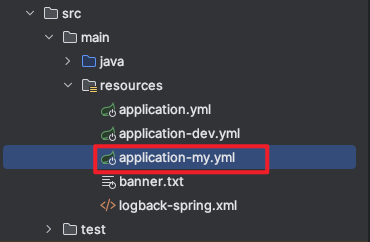
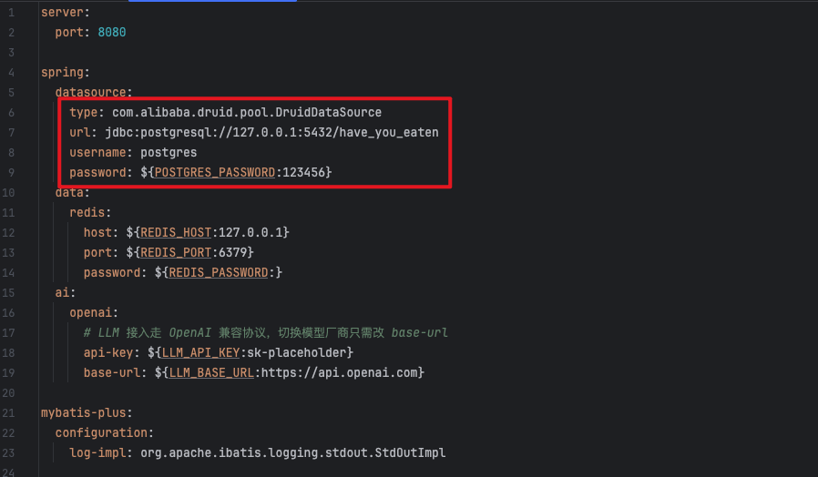
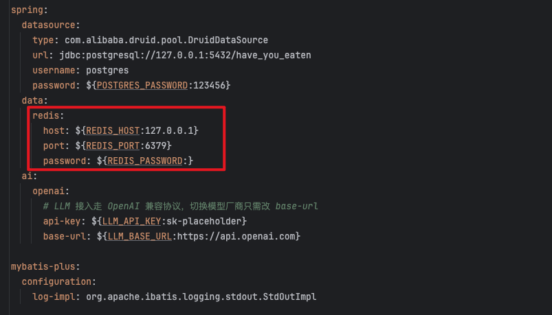
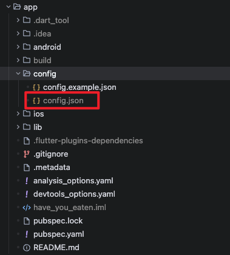

# Have You Eaten（吃了吗？）

> 一个帮你解决「今天吃什么」的双场景决策 App。

## 项目介绍

Have You Eaten 是一个 基于Flutter + Spring Boot 开发的应用。将「吃什么」拆成两个日常场景：

- **在家吃**：从菜谱库里转盘抽签，抽到什么做什么。
- **出去吃**：先抽一个菜系，再把附近的店做成卡牌一张张翻，翻到满意为止。

## 功能特性

- **转盘抽菜**：按菜系筛选后随机抽一道菜，抽中后可直接查看菜谱详情与做法。
- **菜系抽签**：可指定多个菜系，也可留空由系统随机；「换菜系」时自动排除刚抽过的。
- **卡牌翻店**：抽中菜系后返回一组按距离召回、随机排序的店铺卡片；「换一家」本地翻牌不重复请求。
- **附近筛选**：支持菜系多选、人均预算、搜索半径三类条件。
- **记一笔**：确认餐厅后可写入吃过记录，并在记录页分页回看。
- **最近去过降权**：最近 3 天吃过的店自动排到队尾，避免反复推荐同一家。
- **定位与导航**：基于当前位置搜索附近餐厅，可一键唤起高德导航。
- **登录与鉴权**：账号注册登录、令牌刷新，请求侧支持动态 Token + 签名校验。

## 快速开始

### 克隆仓库

```bash
git clone <仓库地址>
cd have-you-eaten
```

### 服务端

1. 配置文件修改

默认配置文件的环境为`my`，复制一份`application-dev.yml`配置文件为`application-my.yml`配置文件。



可选配置项：

| 配置项                                  | 说明                                                         |
| --------------------------------------- | ------------------------------------------------------------ |
| `hye.security.app-key`                  | App 握手凭证，对应 App 的 `APP_KEY`，和`sign-secret`任一为空时为开发模式 |
| `hye.security.sign-secret`              | HMAC-SHA256 签名密钥，对应 App 的 `SIGN_SECRET`，和`app-key`任一为空时为开发模式 |
| `hye.security.token-ttl-seconds`        | access token 有效期（秒），默认 7200                         |
| `hye.security.timestamp-window-seconds` | 请求时间戳允许窗口（秒），默认 ±300                          |

**提示**：启用`app-key`和`sign-secret`校验时，可运行 `src/test/java/com/hye/AuthKeyGeneratorTest.java` 生成一对随机凭证。

2. 初始化数据库

项目使用 PostgreSQL 存储数据，需要启动一个 PostgreSQL 服务。

创建一个名字`have_you_eaten`数据库，执行`docs/init.sql`SQL文件，进行初始化。

默认配置下，默认端口为5432，账号为postgres，密码为123456。如果不一致，请修改`application-my.yml`配置文件。



3. 初始化 Redis

项目使用Redis缓存数据，需要启动一个 Redis 服务。

默认配置下，端口为6379，不设置账号密码。如果不一致，请修改`application-my.yml`配置文件。



4. 导入菜谱数据（可选）

菜谱来自开源项目 [HowToCook](https://github.com/Anduin2017/HowToCook)，由一次性脚本解析成 SQL 后导入。

```bash
git clone --depth 1 https://github.com/Anduin2017/HowToCook.git /tmp/howtocook

python3 docs/import_howtocook.py \
  --repo /tmp/howtocook \
  --out docs/recipes.sql \
  --image-dir public/images/recipes \
  --image-base http://localhost:8080/images/recipes
```

可选参数：

| 参数 | 说明 |
|---|---|
| `--out` | SQL 输出路径，默认 `docs/recipes.sql` |
| `--image-dir` | 封面落盘目录，默认 `public/images/recipes` |
| `--image-base` | 图片访问前缀，默认 `http://localhost:8080/images/recipes`；真机调试改成电脑局域网 IP，上线后换成正式域名 |
| `--include-dessert` | 一并导入甜品目录，默认跳过 |
| `--limit N` | 只处理前 N 道，用于调试解析效果 |

生成后运行`docs/recipes.sql`SQL文件。

5. 启动服务端

```bash
cd server
mvn spring-boot:run
```

默认端口 `8080`，接口统一前缀 `/api`。启动后可访问http://127.0.0.1:8080/doc.html 地址查看全部接口。

### APP 端

1. 配置文件修改

配置文件的默认目录为`config/`，`config.example.json`为默认模版文件，复制一份为`config.json`。



可选配置项：

| 字段              | 说明                                             |
| ----------------- | ------------------------------------------------ |
| `version`         | 应用版本号                                       |
| `APP_NAME`        | 应用名称                                         |
| `BASE_URL`        | 后端地址，真机调试填电脑局域网 IP                |
| `API_URL`         | 接口前缀，默认 `/api`                            |
| `REQUEST_TIMEOUT` | 请求超时时间（毫秒）                             |
| `APP_KEY`         | 握手凭证，与后端 `hye.security.app-key` 一致     |
| `SIGN_SECRET`     | 签名密钥，与后端 `hye.security.sign-secret` 一致 |

2. 启动 App

```bash
cd app
flutter pub get
flutter run --dart-define-from-file=config/config.json
```

## 构建部署

### 服务端

```bash
cd server
mvn clean package -DskipTests
java -jar target/have-you-eaten.jar
```

### App

```bash
cd app
flutter build apk --release --dart-define-from-file=config/config.json     # Android
flutter build ios --release --dart-define-from-file=config/config.json     # iOS
```

## 数据来源

- **菜系与菜谱**：来自开源项目 [HowToCook](https://github.com/Anduin2017/HowToCook)。
- **餐厅**：来自高德 POI 2.0 周边搜索。
